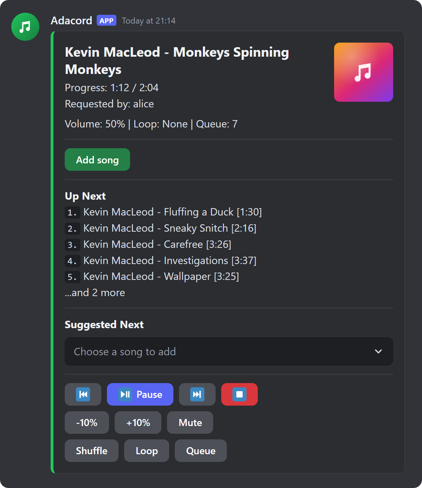
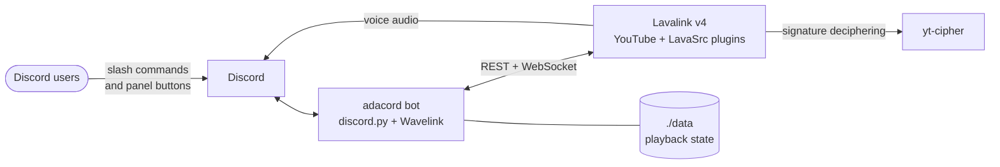

<div align="center">

# Adacord

**A self-hosted Discord music bot with a single player panel that updates in place.**

[](https://github.com/adaresa/adacord/actions/workflows/ci.yml)
[](LICENSE)
[](https://www.python.org/)
[](https://github.com/adaresa/adacord/pkgs/container/adacord)



</div>

Most music bots either post a new message for every track or put basic features behind a premium tier. Adacord keeps **one** message in your music channel: the current track, progress, queue preview, and clickable controls all update in place. It runs on your own machine with Docker Compose, so there is no hosted service, dashboard, or paywall involved.

## Features

- **One persistent player panel** with buttons for pause, skip, restart, stop, volume, mute, shuffle, loop, and the full queue
- **Add songs from the panel** with a modal, including a "play next" option, or pick from **suggested next songs**
- **YouTube** links, timestamps (`&t=241s`), playlists, and plain-text search with ranking that prefers the original upload over covers, slowed or sped-up edits, and live versions unless you ask for them
- **Spotify playlist links**, resolved from public playlist metadata and played through YouTube search (no Spotify audio is streamed)
- **Survives restarts**: the queue, current track, and playback position are saved under `./data` and restored when the bot comes back
- **Quiet by design**: button presses don't post messages, and the panel recreates itself if someone deletes it
- **Docker-first**: one `.env` file and `docker compose up -d`

## How it works



The bot handles Discord and queue logic. [Lavalink](https://github.com/lavalink-devs/Lavalink) resolves tracks and streams audio to Discord voice, and a private [yt-cipher](https://github.com/kikkia/yt-cipher) sidecar handles YouTube signature deciphering. Lavalink and the cipher are only reachable from the Compose network, and the stack publishes no ports. Keep it that way: their internal passwords are fixed in the Compose and Lavalink config.

## Quick start

You need a machine that runs Docker with the Compose plugin (Lavalink is capped at a 512 MB Java heap, so a small VPS or home server is enough) and a Discord server where you can add bots.

### 1. Create the Discord bot

1. Open the [Discord Developer Portal](https://discord.com/developers/applications) and create an application.
2. On the **Bot** page, reset and copy the bot token. Adacord needs no privileged gateway intents.
3. Invite the bot with this URL after replacing `YOUR_APPLICATION_ID` (it's on the **General Information** page):

   ```text
   https://discord.com/oauth2/authorize?client_id=YOUR_APPLICATION_ID&scope=bot+applications.commands&permissions=36785152
   ```

   That grants View Channels, Send Messages, Embed Links, Read Message History, Connect, Speak, and Use Voice Activity.

### 2. Get the code and configure it

```bash
git clone https://github.com/adaresa/adacord.git
cd adacord
cp .env.example .env
```

Edit `.env` and set at least:

```env
DISCORD_TOKEN=your-discord-bot-token
DISCORD_GUILD_ID=your-server-id
```

`DISCORD_GUILD_ID` is optional but recommended: slash commands then appear in that server right away instead of after Discord's global rollout. To find the ID, turn on **Developer Mode** in Discord's settings, then right-click your server and choose **Copy Server ID**. Adacord is built for one server, and with this set it also removes its global commands, so leave it empty if you add the bot to several servers.

### 3. Start it

```bash
docker compose up -d
docker compose logs -f bot
```

Join a voice channel and run `/play never gonna give you up`. The player panel appears in the channel where you ran the command.

## Commands

| Command | Description |
| --- | --- |
| `/play <query>` or `/p <query>` | Play or queue a YouTube URL, search terms, or a Spotify playlist link. YouTube timestamps such as `&t=241s` start at that point, even from the queue. |
| `/join` | Join your voice channel and open the player panel without queueing anything |
| `/remove <position>` | Remove a track from the queue |
| `/move <from_pos> <to_pos>` | Move a track to another queue position |
| `/disconnect` or `/dc` | Leave voice and remove the player panel |

Everything else lives on the panel. **Stop** clears playback and the queue but keeps the bot in voice; use `/dc` to make it leave.

## Configuration

All settings go in `.env`. Only `DISCORD_TOKEN` is required.

| Variable | Default | Description |
| --- | --- | --- |
| `DISCORD_TOKEN` | — | Bot token from the Developer Portal |
| `DISCORD_GUILD_ID` | empty | Sync slash commands to this one server for instant updates |
| `DEFAULT_VOLUME` | `50` | Starting volume, `0`–`200` |
| `PLAYER_IDLE_TIMEOUT` | `30` | Seconds with nothing playing before the bot leaves voice; `0` disables auto-leave |
| `VOICE_CONNECT_TIMEOUT` | `30` | Seconds to wait for Discord to finish joining a voice channel |
| `YOUTUBE_OAUTH_ENABLED` | `false` | Sign Lavalink in to YouTube; see [YouTube on a VPS](#youtube-on-a-vps) |
| `YOUTUBE_OAUTH_REFRESH_TOKEN` | empty | Refresh token printed by Lavalink during OAuth setup |
| `YOUTUBE_OAUTH_SKIP_INITIALIZATION` | `true` | Set to `false` once to run the OAuth device login |
| `COMPOSE_PROFILES` | empty | Set to `watchdog` to enable the [playback watchdog](#optional-playback-watchdog) |

### YouTube on a VPS

YouTube is stricter with datacenter IP addresses than with home connections. If Lavalink logs `This video requires login` for ordinary public videos, enable OAuth with a dedicated, throwaway Google account (not your personal one). The step-by-step flow is in [docs/deploy.md](docs/deploy.md#youtube-oauth).

### Optional playback watchdog

Lavalink's healthcheck only proves that its HTTP server is up. The watchdog goes further: once a minute it runs a YouTube search through Lavalink and opens a short media sample from up to three results, which catches the case where search still works but every stream fails. After three failed probes in a row it restarts `yt-cipher`, Lavalink, and the bot.

```env
COMPOSE_PROFILES=watchdog
```

```bash
docker compose up -d
docker compose logs -f watchdog
```

> [!WARNING]
> The watchdog mounts `/var/run/docker.sock`, which gives that container control over Docker on the host. Only enable it on a machine you control.

## Updating

```bash
git pull
docker compose pull
docker compose up -d
```

`git pull` brings in Compose and Lavalink config changes; `docker compose pull` fetches the new bot image. Your `.env` and `./data` are untracked and stay as they are.

## Privacy

Adacord stores nothing outside your machine. The bot logs show who requested what (Discord usernames and search queries), and `./data/playback_state.json` keeps requester names for the queue it restores after a restart. Searches go from Lavalink to YouTube, and Spotify playlist links are read from Spotify's public embed page.

## Troubleshooting

| Symptom | What to check |
| --- | --- |
| Slash commands don't show up | Set `DISCORD_GUILD_ID` and restart. Without it, global commands can take a while to appear. Make sure the invite URL included `applications.commands`. |
| `/play` times out joining voice | The bot needs **View Channel**, **Connect**, and **Speak** in that voice channel. Check channel-level permission overrides too. |
| Lavalink logs `This video requires login` | YouTube is blocking your server's IP. Enable [YouTube OAuth](#youtube-on-a-vps). |
| Lavalink logs `Must find sig function` | The cipher sidecar isn't healthy. Check `docker compose logs --tail=80 yt-cipher`. |
| The bot joins but plays nothing | Check `docker compose logs --tail=120 bot lavalink` and the [watchdog](#optional-playback-watchdog) output if it's enabled. |

## Development

```bash
python -m pip install -r requirements-dev.txt
python -m pytest
```

The tests run offline against fake Discord and Wavelink objects, so they need no token and no Lavalink. CI also compiles every module and validates the Compose files:

```bash
python -m py_compile adacord/*.py tests/*.py
docker compose config --no-interpolate
COMPOSE_PROFILES=watchdog docker compose config --no-interpolate
docker compose -f docker-compose.yml -f docker-compose.override.example.yml config --no-interpolate
```

To run the stack with your local code instead of the published image:

```bash
cp docker-compose.override.example.yml docker-compose.override.yml
docker compose up -d --build
```

After that, `docker compose up -d --build bot` rebuilds just the bot. For live testing, use a separate Discord application and token: two processes logged in with the same token interfere with each other's voice sessions.

### Project layout

| Path | Contents |
| --- | --- |
| `adacord/bot.py` | Bot bootstrap, command sync, event wiring |
| `adacord/commands.py` | Slash commands |
| `adacord/ui.py` | Player panel layout, buttons, queue view, display refresh |
| `adacord/player.py` | Voice connection, Lavalink player lifecycle, queue helpers |
| `adacord/sources.py` | YouTube search ranking and Spotify playlist resolution |
| `adacord/recommendations.py` | "Suggested next" songs |
| `adacord/persistence.py`, `adacord/recovery.py` | Saving and restoring playback across restarts |
| `adacord/events.py` | Lavalink track and player events |
| `lavalink/application.yml` | Lavalink, YouTube plugin, and LavaSrc configuration |
| `scripts/lavalink-watchdog.sh` | Optional playback watchdog |
| `docs/deploy.md` | Optional automated VPS deployment with GitHub Actions |

## Contributing

Issues and pull requests are welcome. Please run `python -m pytest` before opening a PR and add a test for behavior changes; the existing tests in `tests/` show how to fake Discord and Wavelink objects.

## Acknowledgements

Adacord is built on [discord.py](https://github.com/Rapptz/discord.py), [Wavelink](https://github.com/PythonistaGuild/Wavelink), [Lavalink](https://github.com/lavalink-devs/Lavalink), the Lavalink [YouTube source](https://github.com/lavalink-devs/youtube-source), [LavaSrc](https://github.com/topi314/LavaSrc), and [yt-cipher](https://github.com/kikkia/yt-cipher).

Adacord is not affiliated with Discord, YouTube, or Spotify. You're responsible for using it in line with those platforms' terms.

## License

[MIT](LICENSE)
